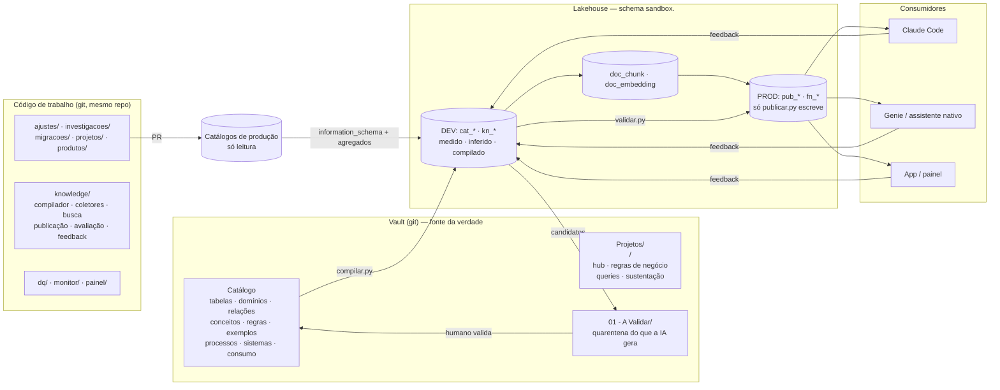
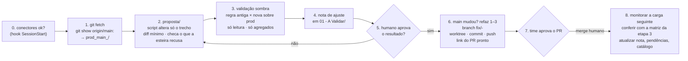
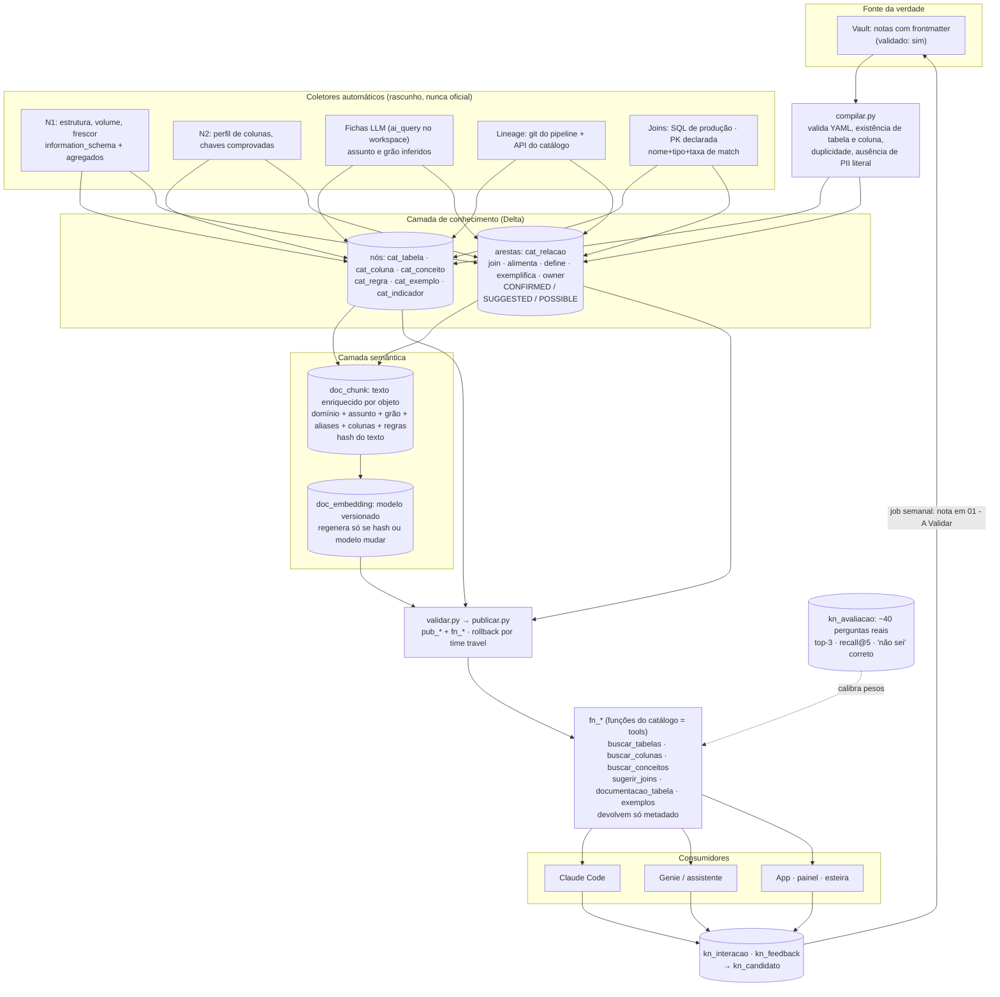

# Plataforma de conhecimento de dados: modelo de aplicação

Como montar, numa empresa nova, os três blocos que fizeram um time de dados operar o Claude com
segurança em 2026: o **catálogo** (conhecimento validado, no vault), o **código de trabalho**
(tudo que muda ou investiga produção) e a **camada de conhecimento e busca** (o catálogo
compilado para máquina, com busca, ferramentas e feedback). Reescrito sem nomes, dados ou
identificadores da empresa de origem. Pressupõe o vault descrito em
[knowledge-vault.md](knowledge-vault.md) e as regras de `~/.claude/rules/brain/`.

## 0. Em uma frase

**Uma plataforma só.** O vault guarda o conhecimento **validado** (fonte da verdade, em git).
O lakehouse guarda o **compilado** (para busca) e o **inferido** (rascunho de modelo). Tudo que
consome (busca, Genie, app, Claude Code) lê a camada publicada e devolve feedback, que vira
candidato em quarentena, nunca edição direta.

## 1. Os três blocos



### 1.1 Catálogo (no vault, não no lakehouse)

Uma nota por entidade, com frontmatter tipado e `validado`. Decisão de desenho: os
enriquecimentos ficam no vault, porque os catálogos de produção são só leitura e porque git dá
revisão, histórico e diff. O lakehouse é fonte de leitura e destino do compilado.

| Pasta | Uma nota por | Campos que importam |
|---|---|---|
| `Tabelas/<catálogo>/<schema>/` | tabela | grão, chave (com `COUNT` vs `COUNT DISTINCT` que comprova), mapa de colunas (origem, regra, PII), linhagem (alimentada por, alimenta), frescor (coluna e última data), `confianca`, `validado` |
| `Domínios/` | assunto de negócio | tabelas do domínio e "a tabela certa para cada pergunta comum" |
| `Relações/` | par ou estrela de join | chave, cardinalidade, `status: CONFIRMED / SUGGESTED / POSSIBLE`, evidência |
| `Conceitos/` | termo de negócio | definição, aliases, como identificar nos dados, dono, versão |
| `Regras/` (no projeto) | regra de negócio | condição em SQL, tabelas, colunas, origem (link do processo ou reunião) |
| `Exemplos/` | pergunta real | resposta, SQL agregado sem literal pessoal, tabelas |
| `Processos/` | fluxo entendido pela ingestão | para que serve (declarado × inferido), lê, escreve, regras, pontos de atenção |
| `Sistemas/`, `Consumo/` | sistema de origem, schema de consumo | gerados de `cat_*`, 1 nota por item, com inventário em CSV |
| `Monitoramento/` | dia | snapshot do inventário, diff (nova, alterada, removida), fila de enriquecimento |
| `Método/` | — | pipeline por tabela, template da nota, regras de PII e de confiança |

**Pipeline por tabela** (o que o agente faz, sempre só com agregados): estrutura → perfil
(`COUNT`, distintos das candidatas a chave, nulos, `MIN/MAX` de datas) → frescor → relações
(ordem de confiança: SQL de produção > histórico de consultas > casamento de nome com taxa de
match medida) → semântica (assunto e grão redigidos do SQL de carga + perfil) → PII por nome e
tipo, sem abrir valor → humano valida.

### 1.2 Código de trabalho

Pasta única, dentro do mesmo repositório do vault, ignorada pelo Obsidian, pelo lint e pelos
links. Nome genérico aqui: `workbench/`.

```
workbench/
├── README.md / CLAUDE.md   mapa das pastas · regras do lakehouse para o Claude (só o específico da empresa)
├── docs/prompts/           prompts reutilizáveis (setup de analista, migração de legado, arquitetura)
├── ajustes/                mudança proposta ou aplicada em produção          AAAA-MM-DD_<tabela>_<tema>/
├── investigacoes/          análise pontual, só leitura                      AAAA-MM-DD_<tema>/
├── migracoes/              tradução de processo legado → plataforma         AAAA-MM-DD_<processo>/
├── projetos/               código de projeto de negócio que segue evoluindo <projeto>/<tema>/
├── produtos/               o que roda sozinho, agendado (job)               <produto>/
├── knowledge/              a camada de conhecimento (bloco 1.3)
├── _arquivo/               descontinuado, guardado para consulta
└── _local_pii/             saída com dado pessoal: NUNCA sobe para o git
```

Convenções que fazem a diferença:

- Pasta de trabalho pontual começa pela **data de início**; passos que rodam em ordem levam
  `NN_` (`00_` é leia-me ou DDL). Arquivo sem `NN_` não tem ordem.
- Dentro de um ajuste: `prod_main_<sha>/` (original de produção, **nunca editado**),
  `proposta/`, `validacao/`, `pr_body.md`. O diff do PR nasce limpo.
- Script já executado é registro: não se edita para atualizar caminho em comentário. Caminho
  antigo se resolve por uma tabela "de → para" no README quando houver reorganização.
- `snake_case`, sem acento, sem espaço. Prefixo `_` = fora do fluxo.
- **Um executor canônico de SQL** (`python scripts/dbx.py "<SQL>"`), uma forma só de chamar,
  recusa `SELECT *` e escrita fora do sandbox, liberado uma vez nas permissões.
- Um **guardrail `PreToolUse`** (exit 2) por via de acesso a dado: CLI e MCP.

**Ciclo de um ajuste em produção** (duas aprovações humanas):



### 1.3 Camada de conhecimento e busca

Vive em `workbench/knowledge/` e escreve só em `sandbox.<plataforma>`. Scripts numerados por
etapa (`k12_cat_coluna`, `k21_semantica`, `k41_joins`, `k42_lineage`, `k60_metricas`...) e
quatro verbos: `compilar`, `validar`, `publicar`, `avaliar`.



Regras do bloco:

- **Rótulo de origem em toda resposta**: FATO (medido ou `validado: sim`), INFERÊNCIA (ficha
  LLM, relação sugerida, ranking), SUGESTÃO (recomendação montada). "Não sei" quando o score
  fica abaixo do limiar.
- **Toda linha do Delta** leva `origem` (`vault | llm | medido | lineage | feedback`),
  `validado`, `confianca`, `versao_conhecimento`, `atualizado_em`.
- **Grafo sem banco de grafos**: nós em `cat_*`, arestas em `cat_relacao`; "o que alimenta o
  indicador X" é uma CTE recursiva.
- **Busca híbrida** com pesos documentados em config (ponto de partida:
  `0,45 cosseno + 0,15 nome exato + 0,10 alias + 0,08 domínio + 0,07 qualidade do metadado + 0,05 uso + 0,05 feedback + 0,05 validado`),
  calibrados pelo dataset de avaliação.
- **DEV e PROD no mesmo schema**, separados por prefixo: `cat_*`/`kn_*` são rascunho; `pub_*`
  e `fn_*` são publicados, escritos só por `publicar.py` depois de `validar.py`, com
  `RESTORE TABLE ... VERSION AS OF` como rollback. Dispensa schema novo e service principal
  no MVP.
- **Modelos do próprio workspace** para fichas, plano e tradução (sem gastar tokens do Claude
  Code); benchmark de 20 casos antes de escolher; uso registrado em `llm_uso`.
- **DQ** como regras em tabela (`dq_regra`, `dq_vinculo`), job diário, exclusão lógica e log de
  alteração; **monitor do catálogo** com snapshot, diff e fila; **painel** lendo só o schema da
  plataforma.

## 2. Ordem de aplicação numa empresa nova

Cada fase tem entrega, critério de pronto e o que pede do humano. Nenhuma pede acesso novo à
plataforma antes da última.

| Fase | Entrega | Pronto quando | Humano |
|---|---|---|---|
| **0. Diagnóstico** (1 semana) | Para cada fonte (catálogo, lineage, histórico de consultas, endpoints de LLM, busca vetorial): o que dá e o que não dá para extrair **sem pedir nada**. Tabela "sem o recurso / com o recurso" | Decisão registrada de quais pedidos à plataforma são substituídos por solução própria | Valida o plano |
| **1. Base** (1 semana) | Vault no padrão de [knowledge-vault.md](knowledge-vault.md); `workbench/` com README e CLAUDE.md do lakehouse (só o específico: catálogos, warehouse, perfil, regra de escrita); skills oficiais da plataforma; executor canônico de SQL; guardrails CLI e MCP; hook de conexões; `.gitleaks.toml` e `.gitignore` de dados | `doctor` verde; `SELECT *` em tabela pessoal bloqueado em teste | Faz os logins |
| **2. Catálogo piloto** (2 semanas) | Um domínio, 15 a 20 tabelas, pelo pipeline por tabela; templates de nota; `Monitoramento/` com snapshot e diff diário | Todas as tabelas do domínio com grão, chave e linhagem `validado: sim` | Valida as notas (gargalo real: concentre em um dia da semana) |
| **3. Inventário automático** (1 a 2 semanas) | N1 em toda a ingestão **e** toda a camada de consumo: `cat_tabela`, `cat_coluna`, volume, frescor, PII por nome e tipo; fichas LLM como INFERÊNCIA; notas de `Sistemas/` e `Consumo/` geradas | Cobertura 100% da estrutura; fichas em 95%+; achados registrados (tabela quebrada usada por produção, cópia acumulada) | Lê os achados |
| **4. Compilar e buscar** (2 semanas) | `compilar.py` vault → Delta; chunks e embeddings por hash; busca híbrida; `fn_*`; `kn_avaliacao` com ~40 perguntas reais e primeiro relatório | Top-3 ≥ 75% e "não sei" correto ≥ 90% no dataset | Revisa o dataset (30 min) |
| **5. Relações, DQ e monitor** (2 semanas) | `cat_relacao` com SUGGESTED e POSSIBLE do SQL de produção e das PKs; lineage por git e API; regras de DQ com job diário; alertas de frescor na fila | CONFIRMED só por validação; DQ rodando sem falso positivo gritante | Confirma relações em lote |
| **6. Flywheel e consumo** (2 semanas) | `kn_interacao`, `kn_feedback`, `kn_candidato`; job semanal que vira candidato em nota de quarentena; publicação `pub_*` com rollback; assistente nativo gerado do compilado; ingestão de conhecimento (arquivo + "para que serve") | Um ciclo completo feedback → candidato → nota → validado → republicado | Valida candidatos acumulados |
| **7. Escala** (quando os números pedirem) | Busca vetorial gerenciada só se latência da busca SQL passar de ~10 s ou a base passar de dezenas de milhares de vetores; schema de produção e service principal; repositório corporativo | Decisão com latência e acerto medidos | Pedidos à plataforma |

Referências de escala do caso de origem, para calibrar expectativa: busca em SQL com 15 mil
vetores em 0,2 a 0,5 s e 50 mil em ~2 s; ficha LLM ~730 tokens por tabela; carga inicial de
embeddings de ~10 mil chunks ≈ 4 milhões de tokens; acerto top-3 subiu de 78% para 90% em
duas calibrações com candidatos lexicais.

## 3. Papéis

| Quem | Faz | Nunca faz |
|---|---|---|
| **Scripts** | tudo determinístico: coletar, perfilar, compilar, diff, lint, publicar, custo | julgamento |
| **Claude Code** | orquestra, redige notas em quarentena, propõe ajustes, constrói a plataforma | login, token, escrita fora do sandbox, merge, apagar nota |
| **Modelo do workspace** (barato) | fichas, plano técnico, tradução, análise de alerta | virar FATO sem validação |
| **Assistente nativo** (Genie ou similar) | segunda opinião semântica, pontual; consumidor do compilado | rodar em massa |
| **Humano** | valida, aprova resultado, aprova PR, liga regra de alerta, pede acesso | editar `CLAUDE.md` gerado à mão |

## 4. Paradas obrigatórias

O agente para e pede ok antes de: recurso com custo fixo (endpoint de busca vetorial,
assistente dedicado, app, serving); alterar um space ou assistente existente; `ALTER`/DDL em
tabela do núcleo da plataforma; qualquer escrita fora do schema da plataforma; `deploy`,
`run` ou `destroy` em produção; criar tabela nova no sandbox (diz qual e por quê).

## 5. O que muda de empresa para empresa

Tudo isto é parâmetro, nunca código: nomes dos catálogos e do schema da plataforma, id do
warehouse e perfil do CLI, taxonomia de PII (reaproveite a da plataforma, ex.: tags
`class.*`), endpoints de modelo disponíveis, repositório e esteira do pipeline, ferramenta de
tickets, canal de alerta (Teams, Slack), horário de janela do warehouse compartilhado, quem
valida. Vai para o `CLAUDE.md` do `workbench/` e para `config/*.yaml` da camada de
conhecimento.

## 6. Riscos e mitigação

| Risco | Mitigação |
|---|---|
| Fonte da verdade em repositório pessoal | pedir repositório corporativo antes de PROD; segunda cópia em armazenamento da empresa |
| Modelo inventa descrição | rótulo de origem; ficha nunca vira `validado`; "não sei" abaixo do limiar |
| Dado pessoal vaza para o modelo | só metadado e agregado; guardrails em todas as vias; compilador recusa literal pessoal em exemplo; limpeza antes da ingestão |
| Validação humana é gargalo | fila em `01 - A Validar/` com "nota do dia" sugerida; validar em lote num dia fixo |
| Warehouse compartilhado | rodadas pesadas só fora do horário comercial, uma por vez |
| Conflito de escrita concorrente no Delta | `INSERT` sem ler o destino, lotes, retry |
| Tudo roda na conta de uma pessoa | registrar como risco aceito; migrar para service principal na fase 7 |

## 7. Métricas que dizem se está funcionando

Acerto top-3 e recall@5 da busca; taxa de "não sei" correto; cobertura (tabelas com grão e
chave validados ÷ total); % de respostas FATO vs INFERÊNCIA; fila de validação em dias;
custo por rodada (tokens e tempo de warehouse); score de qualidade de uso do Claude (cache,
erros de ferramenta, custo por requisição).
